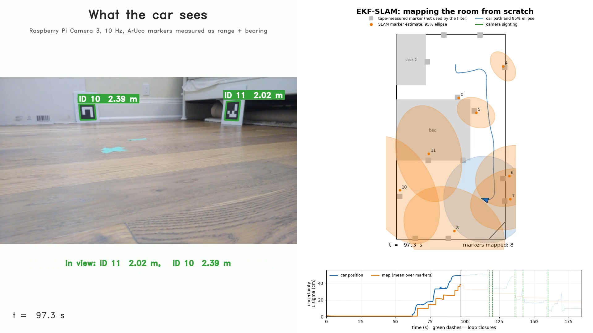
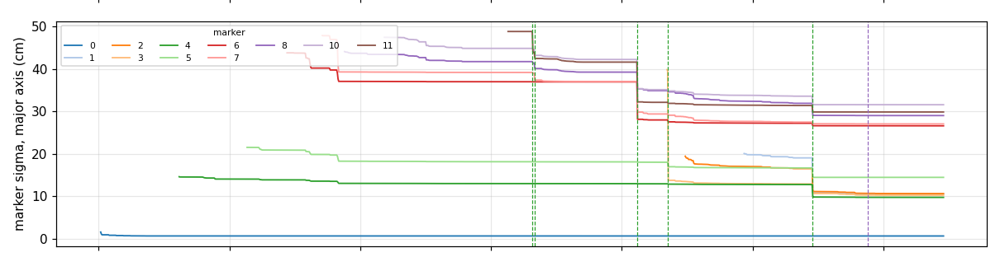

# EKF-SLAM from scratch on a Raspberry Pi 5 car

A small skid-steer robot car maps a room of ArUco markers with **landmark EKF-SLAM written from scratch in NumPy**, using a monocular camera and a gyro and **no wheel encoders**. Every model (camera, motion, noise) was measured on the car, and every result is scored against a tape-measured ground-truth map, so that both the error and the honesty of the uncertainty can be checked.


[](https://github.com/karinamoffat/SLAM/blob/main/SLAM_demo.mp4)


_Side by side comparison of the camera view, mounted on the Pi Car, and the mapping happening simultaneously_

## Results

**EKF-SLAM on three tested drives**:

| Drive     | Markers inside their 95% ellipse                                                             | Map error (RMS)    | Filter recoveries |
| --------- | -------------------------------------------------------------------------------------------- | ------------------ | ----------------- |
| run 4     | 11 of 12                                                                                     | 10.2 cm            | 6                 |
| run 5     | 10 of 11                                                                                     | 8.4 cm             | 3                 |
| run 6     | 11 of 11                                                                                     | 9.8 cm             | 1                 |
| **Total** | **32 of 34 (94%, and an honest 95% ellipse should contain the truth about 95% of the time)** | **8.4 to 10.2 cm** |                   |

The map is scored after a rigid alignment to the tape map (the filter's frame is the car's start pose). Each marker is left out of its own alignment, and the alignment's own uncertainty is propagated into that marker's test. Otherwise the anchor marker would be unfairly graded.

**Uncertainty collapsing at loop closures** Markers the car is not looking at shrink too, through their correlation with the car:

<p align="center"></p>

**Is the filter honest?** Graded on the first marker sighting after 1 s or more of blind driving (normalized innovation squared (NIS) ideal mean is 2 and 95% should be inside):

| Localization against the known map, drives 4 to 6 (33 graded sightings) | Mean NIS | Inside 95% |
| ----------------------------------------------------------------------- | -------- | ---------- |
| **Held out**: noise scaling is tuned on earlier drives                  | 2.62     | 94%        |
| After fitting the pivot model on these same drives                      | 2.00     | 94%        |

**Simulation with known truth** (`pipeline/sim_drive.py`: 6 drives of the same route): 76 of 76 markers inside their 95% ellipses, 4.4 to 8.8 cm map error. The estimators were tested this way before they ran on real data to separate code bugs from model problems.

**Speed on the Pi 5:** 34 µs per predict step (100 Hz) and 63 to 96 µs per update with up to 25 states.

## How it works

```
camera 30 fps ──(10 Hz)──┐
MPU-6050 gyro 100 Hz ────┼── ros2 bag ── replay_extract.py ── .npz ──┬── ekf_localize.py (known map)
/cmd_vel -> motor_node ──┘    (on the car)   (marker detection,      ├── ekf_slam.py (map from scratch)
          /cmd_applied                         once per drive)        └── render_slam.py (video)
```

- **State:** car pose (x, y, heading) plus every marker seen so far, 3 + 2N.
- **Predict (100 Hz):** heading from the gyro (bias measured from the still start of each drive, scale 1.03 measured from heading closure). Translation from the command, with speed measured from marker ranges (0.40 m/s) and braked pivots modelled as rotations about measured points on the car. Process noise grows with distance and angle and was scaled x4 after testing on real drives.
- **Update:** range and bearing to each marker from `solvePnP`, with a measured noise model (σ_r = 0.5 cm + 0.35 cm/m² × r², σ_b = 1°, valid 0.6 to 2.5 m), a chi-square gate (99%), and Joseph-form covariance updates.
- **New markers** join the state after 3 agreeing sightings within 1 s, initialised with the inverse measurement model and full cross-covariances. Only IDs 0 to 12 are accepted (spare prints were in the room). The tape positions are never used by the filter.

**Calibration and measurement work behind it:** intrinsics from 28 checkerboard images (RMS 0.40 px). The camera-to-car transform came from a floor checkerboard, then was re-measured from the floor line (`calibration/floor_tilt.py`). A corner-localisation bias found by comparing refinement methods on identical frames against tape (range error at 2.2 m: +118 mm unrefined, +60 mm AprilTag) and corrected by pushing each detected edge out 0.4 px.

## What went wrong and lessons learned

- **Gate lock-out.** An overconfident filter rejected 49% of sightings on one drive, including the ones that would have fixed it. Fix: an more honest noise model (tested with NIS), plus a recovery rule that widens the covariance after 5 consecutive rejections.
- **Correlated sightings.** A stopped car sees the same marker 10 times a second with the same small bias, so the filter treated them as independent and its position sigma collapsed to 2 mm. Fix: at most one update per marker per second while stopped.
- **Stalled pivots.** Pivot noise scaled with the angle turned, so a pivot that rubbed a cabinet and shoved the car 20 cm while barely turning added almost no noise, and the error froze into the map. Fix: noise from the rotation that was commanded but missing (`K_SLIP`). Recoveries dropped from 8/6/6 to 6/3/1.
- **A sign bug no other test could see.** The left and right motor channels were swapped from day one. Straight-line tests cannot tell, but the gyro showed every turn mirrored. Rule since then: check every new input's sign against an independent sensor.
- **Scoring needed its own uncertainty.** The first scoring failed the anchor marker on every run: it has tiny uncertainty relative to the start, but the alignment that places it is built from the other, uncertain markers.

## Limitations

- **Heading overconfidence.** In 2 of 6 simulated drives the filter's heading drifted 13 to 18° from the truth while it claimed about 4.5° (1 sigma), and in 3 of 6 the car's true position was inside its 95% ellipse only 88 to 89% of the time. One real map came out rotated by 13.7°. The map's shape is unaffected (it passes after alignment), but its orientation is overconfident. This matches the known inconsistency of standard EKF-SLAM (Julier and Uhlmann, 2001, and Huang, Mourikis and Roumeliotis, 2008). An observability-constrained or first-estimates-Jacobian EKF is the natural fix.
- **Not everything is held out.** The pivot points and the slip noise were fitted while looking at the same three drives they are scored on. The noise scaling was not.
- **Both misses are marker 1**, 14 to 15 cm off in the same direction on every drive, which points to its tape measurement rather than the filter.
- **The SLAM honesty test is thin:** only 5 graded sightings per drive (mean NIS 0.2, i.e. cautious). The maps are about 4% too wide east-west in every run, a dead-reckoning bias still to track down.
- Landmarks have known IDs (no data association problem), the world is planar, there are no wheel encoders, and SLAM runs offline on recordings.

## Run it

Needs Python 3 with NumPy, Matplotlib and OpenCV (`pip install -r requirements.txt`). The SLAM pipeline runs anywhere on a simulated drive:

```
cd pipeline
python3 sim_drive.py sim1.npz --seed 1     # simulated drive with known truth
python3 ekf_slam.py sim1.npz               # EKF-SLAM, map score, plots
python3 sim_drive.py sim1.npz --check      # car pose vs the simulated truth
```

The real drives are 1 to 3 GB ROS 2 bags each and are not in the repository. The extracted `.npz` replays are available on request. Recording on the car needs ROS 2 (Lyrical, Ubuntu 26.04) with `camera_ros`, see `car/picar.launch.py`.

## Repository

| Folder         | Contents                                                                                                     |
| -------------- | ------------------------------------------------------------------------------------------------------------ |
| `pipeline/`    | Measurement model, replay extraction, EKF localization, EKF-SLAM, simulator, analysis tools, video rendering |
| `car/`         | ROS 2 launch file, motor and IMU nodes, motor driver, MPU-6050 I2C driver                                    |
| `calibration/` | Intrinsic and extrinsic calibration, floor-line tilt, marker generator                                       |
| `experiments/` | Motion and sensor experiments with their raw logs (see its README)                                           |
| `results/`     | All plots, with a README of what each shows                                                                  |

**Hardware:** Raspberry Pi 5 (8 GB), 4WD aluminium chassis with TT motors (skid steer, no encoders), L298N driver, Camera Module 3 (640×360), MPU-6050 gyro, 13 printed ArUco markers (DICT_4X4_50, 14.6 cm).
